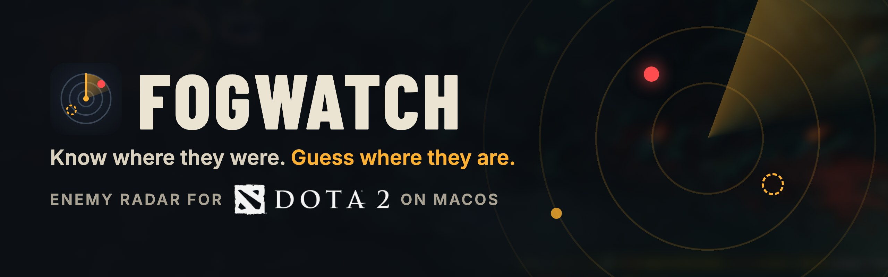
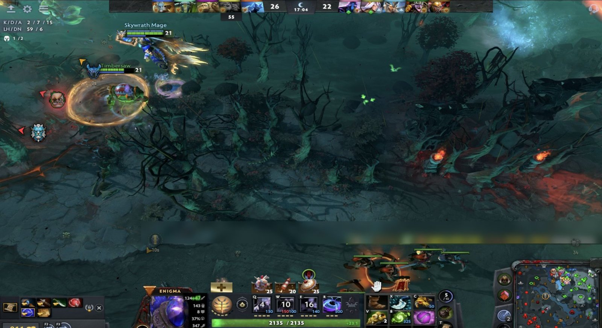
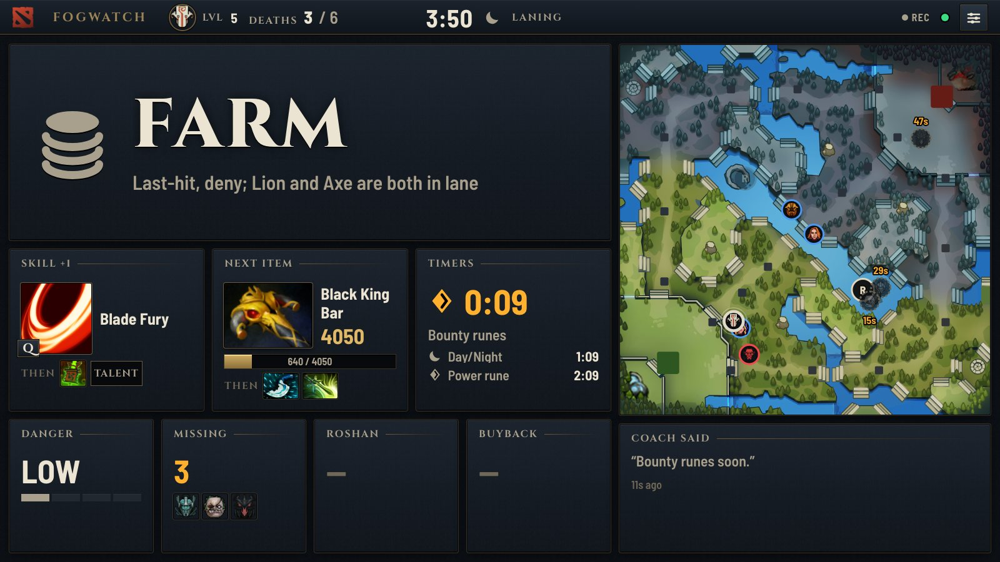
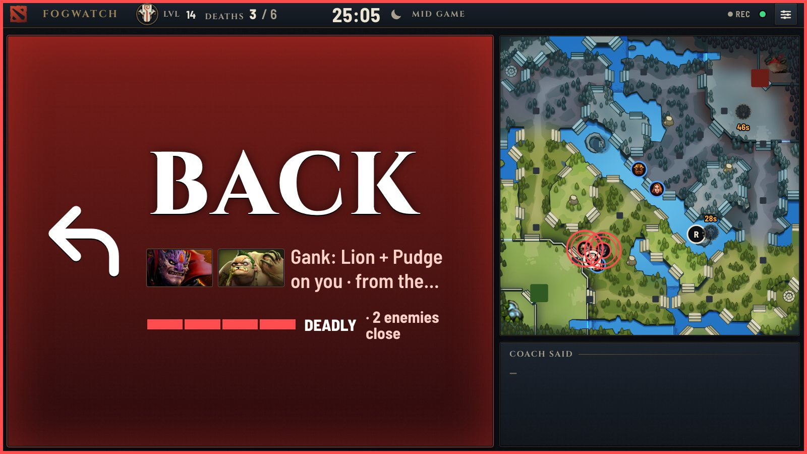
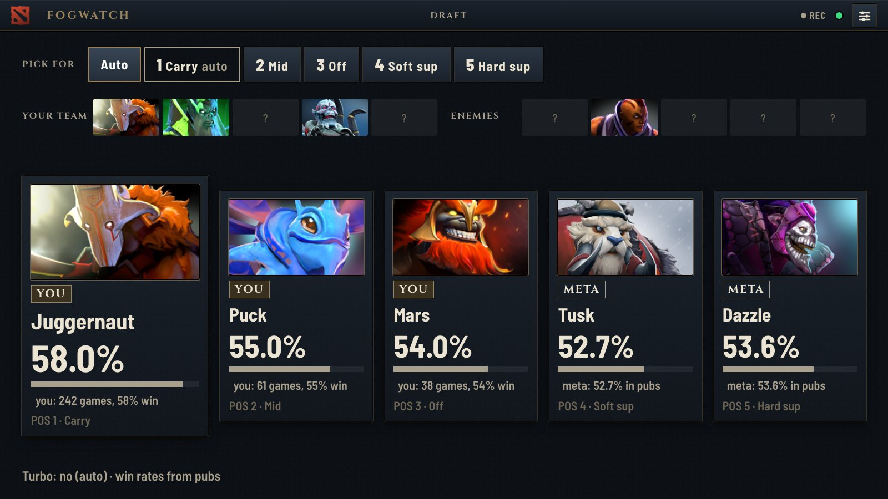
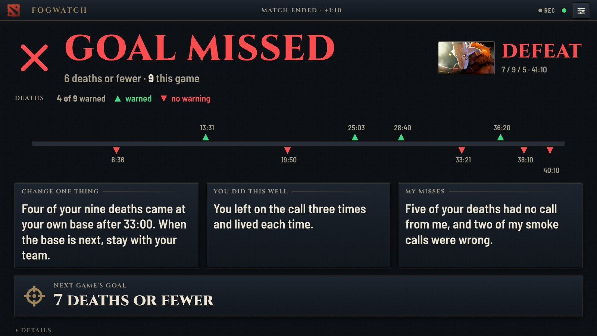

<p align="center">
  <a href="https://imranbug.github.io/fogwatch/"></a>
</p>

<p align="center">
  <a href="https://imranbug.github.io/fogwatch/"></a>
  
  
  <a href="LICENSE"></a>
</p>

<p align="center">
  <b><a href="https://imranbug.github.io/fogwatch/">Website</a></b> ·
  <b><a href="https://github.com/ImranBug/fogwatch/archive/refs/heads/main.zip">Download for Mac</a></b> ·
  <b><a href="https://www.youtube.com/@bug81-d3d">Videos</a></b>
</p>

<p align="center">
  
  <br><sub>A real moment from a recorded game (17:04), radar drawn by Fogwatch from that moment's game state. Chat blurred.</sub>
</p>

Fogwatch puts all five enemy heroes on the edge of your screen while you play Dota 2: **red** when you can see them, **amber** where they were last seen, **grey** once the trail goes cold. No account, no API key, no cost.

<table>
  <tr>
    <td width="33%" valign="top"><h3>🔴 In sight</h3>The icon pops onto the screen edge the moment they appear. Close out of the fog? It lands big, with a red glow.</td>
    <td width="33%" valign="top"><h3>🟠 Last seen</h3>They walked into the fog. The arrow points to where you last saw them, with the seconds since, and their face waits on your minimap at that spot.</td>
    <td width="33%" valign="top"><h3>⚪ Trail gone cold</h3>Once they could be anywhere, the arrow fades into a ring and the icon steps back to a tray above your minimap.</td>
  </tr>
  <tr>
    <td valign="top"><h3>🔺 Gank coming</h3>Heroes from the same side share one arrow. It pulses when a gank looks close.</td>
    <td valign="top"><h3>🟢 Teammates</h3>Small, dull green and arrow-free out at the edges, so they never pull your eye.</td>
    <td valign="top"><h3>🧠 Optional AI coach</h3>Your own OpenAI, Jev or Anthropic key adds a game plan, advice and a post-game review. Off by default.</td>
  </tr>
</table>

## Not a cheat. A memory.

Fogwatch can't see into the fog. It only remembers what your own screen already showed you.

- ✅ Reads your own screen (the minimap and HUD) and Valve's official Game State Integration
- ❌ Never reads game memory
- ❌ Never presses a key or moves your mouse
- ❌ Never changes game files (apart from the one config file Valve's integration needs)
- 🔒 Runs on your Mac only: the server listens on `127.0.0.1` and refuses other hosts and non-JSON writes from web pages. With AI off (the default) nothing leaves your computer except downloads of public hero data and icons, and a lookup of your own public match history on OpenDota.

## Quick start (macOS)

**One line** (installs everything and starts Fogwatch):

```bash
curl -fsSL https://imranbug.github.io/fogwatch/install.sh | bash
```

Or by hand:

1. Install [uv](https://docs.astral.sh/uv/): `curl -LsSf https://astral.sh/uv/install.sh | sh`
2. [Download this repo](https://github.com/ImranBug/fogwatch/archive/refs/heads/main.zip) and double-click `start.command`. The first run installs the Python packages and Dota's game-data file (GSI). The dashboard opens at `http://127.0.0.1:3939`.
3. Steam → Dota 2 → Properties → Launch Options: add `-gamestateintegration`, then start Dota.
4. System Settings → Privacy & Security → Screen Recording: allow Terminal, then reopen `start.command`.
5. Play. The radar appears at the horn and leaves at the end screen.

## The dashboard (second monitor)

Draft help, timers, danger, missing enemies and a post-game report, built to be read from the corner of your eye.

<table>
  <tr>
    <td></td>
    <td></td>
  </tr>
  <tr>
    <td align="center"><sub>Laning: one card says what to do</sub></td>
    <td align="center"><sub>Gank coming: the whole screen says BACK</sub></td>
  </tr>
  <tr>
    <td></td>
    <td></td>
  </tr>
  <tr>
    <td align="center"><sub>Draft: picks for your role, with your own win rates</sub></td>
    <td align="center"><sub>After the game: one thing to change, and next game's goal</sub></td>
  </tr>
</table>

**Optional AI coach (your own keys, your own bill):** open the dashboard menu → *AI coach*, paste an OpenAI and/or Jev key and switch *AI on*. It adds a game plan, advice and quick decisions, about $0.02 per game. An Anthropic key adds a post-game review by Claude Opus, about $0.65 per game. Keys are saved only on your computer in `./.env` (see `.env.example`). With AI off, no paid call is ever made: no advice, no decisions, no cloud speech-to-text and no review.

<sub>Fogwatch is not affiliated with or endorsed by Valve. Dota 2 and the Dota 2 logo are trademarks of Valve Corporation. Don't use the coach in ticketed or tournament games.</sub>

---

# Developer docs

Local second-monitor Dota 2 coach (`live-coach`). Inputs are Valve GSI and screen capture with classical CV. Rules run every 250 ms, and an LLM is called now and then to phrase advice. Design: [`docs/ARCHITECTURE.md`](docs/ARCHITECTURE.md).

## Setup details (once)

1. `uv sync`
2. `uv run tools.py install-gsi` writes `.../dota 2 beta/game/dota/cfg/gamestate_integration/gamestate_integration_coach.cfg` and `data/token`.
3. Steam → Dota 2 → Properties → Launch Options: `-gamestateintegration`. Then restart Dota.
4. System Settings → Privacy & Security → Screen Recording: allow the terminal app you run the coach from, then quit and reopen that terminal (macOS applies the grant only after a relaunch). Without this the coach runs on GSI only and retries capture every 5 s; the dashboard's CV chip turns amber and its tooltip shows the reason (`off` = no capture at all, e.g. `--no-cv`).
5. Recommended minimap settings, entered in the Dota console. Recalibrate after you change them.
   ```
   dota_minimap_primary_option 3
   dota_minimap_background_option 1
   dota_minimap_show_cast_range 0
   dota_minimap_hero_scalar 0
   dota_minimap_hero_size 800
   ```
   Leave the extra-large minimap off.
6. LLM (optional): keys and routing are read from `../.env` (shared) and `./.env`. Real environment variables win, then `./.env`, then `../.env`. Without `LLM_BASE_URL` the coach runs on rules only (the fallback is only used behind a primary). Because the `.env` files refill unset variables, turn the LLM off with `--no-llm`, `LLM_BASE_URL= uv run app.py`, or by commenting the line out in the `.env`. `uv run llm.py` makes one tiny test call per provider. The LLM dot turns amber when the last call failed (details in the terminal log; key values are never printed). If `LLM_API_KEY` is unset the key is picked by host: openai.com -> `OPENAI_API_KEY`, anthropic.com -> `ANTHROPIC_API_KEY`, googleapis.com -> `GEMINI_API_KEY`.

## Run

```
uv run app.py              # then open http://127.0.0.1:3939 on the other monitor
uv run app.py --record     # also save recordings/<ts>/gsi.jsonl plus 1 fps minimap/top-bar crops
uv run app.py --demo       # accept hero demo / custom games (needed for the checks below)
```

### Dashboard

The dashboard is built to be read from about 60 cm in peripheral vision. One primary card says what to do (FARM, BACK, DEFEND); fixed slots below it hold the skill point, next item, timers, danger, missing enemies, Roshan and buyback, and the replica minimap keeps the right-hand slot. Colour has one meaning each: green = you can do it now, amber = warning, red = danger/enemy, gold = gold amounts. Motion only fires once when something escalates. Draft picks, the death screen and the post-game report take over the screen on their own.

Everything else (mic, push-to-talk key, role and Turbo overrides, voice, overlay, feedback marks, views, calibrate, Rosh marks, REC and source telemetry) is in the settings drawer behind the slider button top right. Keys: `0`/`a` Auto, `1` Glance, `2` Map, `3` Full, `4` Enemies, `g`/`b` feedback, `m` mute, `Esc` closes the drawer.

For no browser chrome, open it as an app window: `open -na "Google Chrome" --args --app=http://127.0.0.1:3939` (then full-screen it on the second monitor). `?mock` shows demo data (`?mock&sc=fight` pins one scenario: wait, draft, laning, mid, late, fight, dead, rosh, defend, check, talk, post).

## First-run checklist

1. With Dota in a match or hero demo, run `uv run tools.py snap`. Check that the boxes in `data/snap_boxes.png` sit on the top-bar portraits and on the right-side minimap.
2. Open the Dota console and look for `Loading Game State Integration` and any `cannot be provided` lines.
3. In hero demo (`--demo`), check whether GSI `minimap` lists your hero and the enemy units you spawn.
4. Apply the convars above, then walk around for about 30 s so the affine fits (`cv.affine_ok` in `/events`).
5. In hero demo, stand in each Roshan pit and press "Mark rosh_top" / "Mark rosh_bot" (`POST /api/mark?name=rosh_top|rosh_bot`). Until then approximate built-in pit spots are used.
6. Take one `tools.py snap` while an enemy is dead and check `cv.dead`/the lineup: dead detection is tuned on 2021 spectator frames only.
7. Play one game with `--record`, then rerun `selfcheck` and compare `cv.gsi_vs_cv_err_u`.

Don't use the coach in ticketed or tournament games.

## Voice coach

Silence is the default. The voice protects you and gives cues; the teaching happens while you are dead and after the game. A Turbo game has roughly 40-60 spoken lines, most of them urgent calls and death debriefs. Every line is an instruction of 1-9 words, played through the Mac speakers (`afplay`, not the browser).

All audio settings (provider, model, voice, delivery style, base volume, daily cap) live in `voice.env`. Keys stay in `../.env`.

**What is spoken** (`voice.py`; anything not listed here is never spoken):

| Tier | When | Lines |
|---|---|---|
| U urgent | Any time, also in a fight. Has its own two-tone earcon baked into the clip. Cuts in on any non-urgent line at once. Same cue at most once per 25 s, 3 recorded takes each. | "Gank from the river. Back." / "...from the jungle. Back." / "Behind you. Move." / "Gank coming. Back to tower." (R1 warn, by direction), "Get out. Now." (R1 high), "Get out!" (HP under 30% next to an enemy), "Back off. Heal up." (R13, laning), "Don't go. It's lost." (R15), "Still in danger. Leave." (R1 high for 10 s and you have not left) |
| C calls | Never in fight mode, never while R1 is up or within 8 s of an urgent line, at least 20 s after the previous non-urgent line. | "You're too deep. Come back." (R11), "Defend top/mid/bot." / "Defend the base!" / "Let it go. Stay with your team." / "Base is next. Stay with your team." (R10), "Your team is fighting. Join them." (R12), "They lost three. Take a tower." (R14), "They may be on Roshan. Check it." (R4 high), "Wisdom rune soon. Go grab it." (roles 3-5) |
| B brief | Once, at about -0:40. | "One goal this game: six deaths or fewer.", the lane job for your role, and on the first game and every 5th game "Hold your talk key if you want to ask me something." |
| D debrief | While you are dead, from 1.5 s after the death, at most 2 lines. | One cause line ("You were alone. Next fight, stay near a teammate.", "I called it early. Next time, leave on the call.", "My miss. I didn't see that one coming." ...), then "Three left in your budget." or, late in the game, "Buyback is up. Keep it." / "No buyback. Play safe." Three deaths in four minutes get one line instead: "Reset. Next fight is the one that counts." |
| P praise | A quiet moment, at most once per 3 min. | "Good. You got out.", "Good call backing off.", "Nice fight." |
| Thinking prompt | Only when something just changed and the moment is quiet: you are about to respawn, your team won or lost a fight, a push window closed, Roshan died, you saw a big enemy item, the game moved to mid or late. | One LLM sentence of at most 18 words about the next minute. Never a description of the state. No timer: if nothing changed, nothing is said. |

**Timing rules.** A line that cannot start in time is dropped, never said late: calls after 4 s, thinking prompts after 7 s, praise after 6 s. A thinking prompt needs one LLM call and one live TTS call first (measured 4.9-6.3 s with the fallback model, 8-9 s with the primary, so `VOICE_THINK_LLM=fallback` is the default). A call you are already obeying is not spoken (you are already walking home, already at the tower, already walking to the fight). A "go" call (join, take a tower) never follows a retreat call within 12 s. Calls, praise and prompts stop once 3 lines were spoken in the last minute (urgent lines and the debrief do not). Non-urgent lines also stop at the per-game cap: 30 at verbosity normal, 12 at low, 45 at high. After the cap, and at verbosity low from the start, only urgent lines and the debrief's cause line are left. The same non-urgent text is not repeated within 60 s. The voice is silent while paused, while GSI is stale, with `voice: false`, and with `quiet: true` (replies to push-to-talk still play).

**Rules behind the calls** (`rules.py`):

- R1 gank / danger: unchanged score, plus `dir` on the alert (`river`, `jungle`, `behind`). Before 10:00 your two lane opponents do not count, but a third enemy in the lane ends that exemption.
- R13 laning pressure (new): an enemy within 1300 and either HP at 60% or less while dropping 15% in 6 s, or HP at 50% or less and outnumbered.
- R15 chain-feed guard (new): you are walking toward a fight where the allies are dead or outnumbered by two or more.
- R14 objective window (new): three or more enemies dead, you are alive, after laning.
- R12 join fight: not in laning, not while R1/R11/R13/R15 or a retreat decision is up, only with HP at 60% or more and at least as many allies in the fight as enemies, once per 60 s.
- R2 missing and R3 smoke are level `info`: amber on screen, never spoken.
- The card word comes from the decision model only at confidence 0.6 or more; otherwise it is the phase default (FARM, SUPPORT, GROUP). No model name or percentage appears in player-facing text.
- Precision gate: `postgame.rule_tuning()["demote"]` lists rules with 10 or more recorded episodes of which under half were useful. Those are shown as `info` and not spoken until they recover.
- Turbo is auto-detected from gold per last hit and re-checked until 8:00. The Stack cut-off and the Tormentor timer follow the mode.

**One goal per game** (`coach.py`). The goal is a death budget: `max(3, round(0.75 x average deaths of your last 5 games))`, clamped to 3-10, and 6 with no history. It is said before the horn, counted live in `W.goal`, scored in the post-game report and stored in `data/profile/games.jsonl`, so `W.history` (last 5 games, newest first, and the next goal) survives restarts. `W.debrief` holds the cause of your last death, who was near, the call the coach made before it and the budget line, from the death until 5 s after the respawn.

**Settings** (`POST /api/settings`, saved in `data/settings.json`):

- `voice` true/false, `volume` 0-1 (multiplies `VOICE_VOLUME`), `verbosity` low/normal/high, `commentary` true/false (thinking prompts).
- `quiet` true/false: nothing but replies until the next match. Cleared when a new match starts.
- `POST /api/voice-test` plays "I'm here. You'll hear me like this." at the current volume.
- `W.coach` shows `quiet`, `eased` (rules eased by "bad call", with the clock they come back), `spoken` / `cap`, `verbosity`, `volume`, `demoted`.

**Library.** Lines are TTS clips cached forever in `data/voice/<provider>-<voice>/<slug>[.v2|.v3].wav` and indexed in `data/voice/library.json` (text, tier, take, earcon, secs, usd, uses). The takes of a line are picked at random. Providers: `VOICE_PROVIDER=auto|gemini|openai` (Gemini `gemini-3.8-flash-tts`, OpenAI `gpt-4o-mini-tts`).

There is never a robotic fallback. A line without a clip is skipped and logged as a `miss`, then generated in the background: at most `VOICE_GEN_PER_MIN=12` per minute and `VOICE_GEN_DAILY` requests per day. An urgent line only plays from a clip that has the earcon.

```
uv run voice.py --gen             # record every line of the bank with its takes (cached takes are skipped); --force re-records an older style
uv run voice.py --list            # every line with the length of each take, and the cost
uv run voice.py --stats           # library: clips per bank/source, plays, top lines, requests and $ per day
uv run voice.py --audition        # two lines in 8 voices of the active provider (no playback)
VOICE_VOLUME=0.3 uv run voice.py --say "Get out!"
uv run voice.py --check           # self-check (no audio, no network)
```

Runs with `--replay`, `--frames` or `--data-dir` are dry runs: lines go to the log only. Set `VOICE_DRYRUN=0|1` to override. Every line is logged in `events.jsonl` as `kind: "voice"`:

- `op: hit | miss` with `cue`, `tier`, `text`, `reason`, `delay` (seconds from the trigger to the start of the line), `fight`, `secs`
- `op: drop` (expired, with the reason and how long it waited), `op: obeyed` (held back because you were already doing it), `op: live` for thinking prompts
- `kind: "debrief"` for each death: `cause`, `called`, `by`, `budget`

`W.voice` holds `enabled`, `fight`, `last`, `clips_ready`, `queue`, `provider`, `blocked`, `today`, `spoken`, `urgent`, `cap` and `commentary`.

## Talk to the coach (voice input)

`listen.py` lets you talk to the coach. **Hold the push-to-talk key** (default `mouse4`, the back side button on the mouse) and speak, then let go. Dota doesn't bind mouse4 by default. The audio is transcribed, sent with the game state and the conversation so far to one LLM call, and the coach answers out loud in up to 20 words through the voice TTS. You can tell it facts ("enemy Lion has blink", "I'm going Roshan", "I'm pos 4"), ask questions ("where's their carry?"), give commands ("less talking", "more commentary", "coach mute"), or just vent. Venting gets at most one reply per 45 s, and only when a reply helps. There is no realtime voice API.

- **Modes**: `W.settings.mic_mode` is `"ptt"` (default) | `"always"` (open mic; an utterance ends after a 1.2 s pause, and recognition pauses while the coach is talking so it never hears itself) | `"off"`. `W.settings.mic: false` mutes everything. The settings drawer (the slider button top right) has a mode button (PTT -> ALWAYS -> OFF), a key field and a Mute button; key `m` toggles mute, and the top strip shows MIC MUTED while muted. The API is `POST /api/settings {"mic_mode": "always"}`, `{"ptt_key": "ctrl+f13"}` or `{"mic": false}`. Keys: `mouse3`/`mouse4`/`mouse5`, `f1`-`f20`, letters, digits, `space`, `tab`, `` ` ``, each optionally with `ctrl+`/`alt+`/`shift+`/`cmd+`.
- **The app never presses keys.** The hotkey is read through a macOS *listen-only* event tap (`kCGEventTapOptionListenOnly`) in `listen_helper.swift`. Every event goes on to the game unchanged, and nothing is ever posted or injected.
- **Speech-to-text**: Apple's on-device `SFSpeechRecognizer` (free). It needs **System Settings -> Keyboard -> Dictation** turned on. If on-device recognition is unavailable (Dictation off), the recorded press is sent to OpenAI `gpt-4o-mini-transcribe` instead (~$0.003/min of speech). Silence is never uploaded, and nothing is uploaded while muted.
- **Helper and permissions**: the first start compiles `listen_helper.swift` to `data/listen-helper` (needs the Xcode command line tools, `swiftc`). The helper carries its own Info.plist and runs as its own TCC identity, because the terminal can't own speech permission. macOS asks once for each of these; allow **listen-helper** in System Settings -> Privacy & Security -> **Microphone**, -> **Speech Recognition**, and -> **Input Monitoring** (needed for keyboard hotkeys). A changed `listen_helper.swift` rebuilds the binary, and macOS asks again.
- **Keywords** (no LLM needed): "bad call" or "that was wrong" eases the rule behind the last spoken call for 5 minutes (amber on screen, not spoken; it also counts as a thumbs-down in the post-game scorecard) and answers "Okay, easing off those calls." "Why?" speaks the reason for the last call, for example "Enemies vanished near you." "Quiet" silences everything but replies until the next match; "talk again" brings the voice back. A press with no speech gets "Didn't catch that." A soft blip plays on key down and key up.
- **What it changes**: `W.settings.verbosity` (`low` = only urgent calls, no commentary | `normal` | `high` = more commentary), `W.settings.commentary` (bool), `voice`, `mic`, and `role`. Facts the player states go to `W.player_notes` (last 8, `{clock, text}`). `world.to_text()` appends them as ` | player says: ...`, plus ` | player wants: <focus>` and ` | player mood: <mood>` (when not calm), so the LLM advice, Jev, the voice commentary and the build all see them. The voice cues and commentary in `voice.py` are expected to honour `verbosity` and `commentary`.
- **`W.talk`**: `{mic, mode, key, state (off|starting|on|denied), err, engine (on-device|cloud), tap, input_monitoring, listening, stage (idle|recording|transcribing|thinking|speaking|done), stage_age_s, partial, heard, reply, turns, busy, usd, dev, emotion, mood, focus}`. The dashboard shows `stage` / `heard` / `reply` as a large card that stays for 6 s after `done`.
- **Logging**: each utterance becomes an `events.jsonl` row of kind `voice_cmd` with `{text, intent (question|info|command_settings|command_mute|venting|request_advice|other), emotion (calm|frustrated|tilted|excited|confused|tired), response, settings_changed, fast, note, focus, ms, stt_ms, usd, model}`. Dev mode (`TALK_DEV=1`, default) sends *every* utterance to the LLM, including keyword commands, which are applied at once and only labelled by the LLM. That builds a dataset for a cheap keyword -> intent matcher. `TALK_DEV=0` handles keyword commands locally and sends only the rest.
- **Cost**: STT is free on-device. Per utterance there is one LLM call (~1.5k tokens in, $0.0002-0.001) plus reply TTS (~$0.0005), so about $0.01-0.05 for a game with 30 utterances. `TALK_MAX_USD_PER_GAME` defaults to $2 in dev and $0.30 otherwise; after that only keyword commands work.
- `--no-mic` turns it off. Test runs (`--replay`, `--frames`, `--data-dir`) never open the mic unless `LISTEN=1`. `uv run listen.py --file x.aiff --mode ptt` prints what the helper hears from a file.

## Post-game report and player profile

When a match ends (GSI `POST_GAME` or `win_team`, or GSI silent for 60 s mid-game after 10:00), the server analyzes every recorded session of that match in the background. A match split over several sessions by restarts counts as one match. The server writes `report.json` and `report.md` into the match's last session dir and sets `W.postgame` for the dashboard. It upserts the game into `data/profile/games.jsonl` and rebuilds `data/profile/profile.json`. Games shorter than 10 min are left out of the profile.

The report covers: result, KDA, LH/DN, GPM/XPM, LH@5/10, levels, items, and the earned-gold curve. Each death gets its zone, the enemies within 1500, how many enemies were missing, the nearest ally, and whether the coach warned in the 20 s before. It also lists buildings lost and Roshan kills, then a coach scorecard: per-rule useful / likely-false / unclear, how often you responded vs ignored a warning, deaths with no warning, Jev/LLM cost, and CV health. Rule-based highlights and lessons follow. One LLM call per match (cached in `report.json`, skipped with `--no-llm` or no LLM config) adds a 5-bullet debrief and 3 goals.

```
uv run tools.py postgame                         # latest recorded match
uv run tools.py postgame recordings/<dir>        # that match (its other sessions are added), then compacts it
uv run tools.py compact [--all] [DIR ...]        # dry run: what would be deleted, and the sizes
uv run tools.py compact --all --yes              # really compact every analyzed, finished match
```

Compaction runs after a successful report and games.jsonl entry, never on a failed analysis. It merges a match's session dirs into `recordings/<first-ts>_<matchid>/`. That dir keeps `meta.json`, `report.*`, `gsi.jsonl.gz` and `events.jsonl.gz`, plus `world.jsonl.gz` downsampled to 0.2 Hz. Frames are cut to the `full_` frames within 10 s of deaths, high alerts, feedback marks and building losses, plus one minimap crop per 30 s. `cv.jsonl` is dropped; its summary stays in the report. A typical match goes from about 400 MB to about 25 MB. Replay, review and postgame all read the `.gz` files, so `--replay recordings/<dir>/gsi.jsonl` still works.

Compaction never touches the newest session dir or any dir written in the last 2 minutes. That's why the live app compacts *earlier* analyzed matches when a game ends (only when recording is on); the match that just ended is compacted at the end of the next game.

`postgame.profile_hints(hero, role)` returns up to 400 chars of personal tendencies for prompts. `postgame.rule_tuning()` returns per-player rule knobs; its docstring lists them. `tools.py review DIR` is the single-session diagnostic and writes `DIR/review.md`.

## Dev (no game needed)

```
uv run tools.py selfcheck                  # PASS/FAIL per check, exit 1 on any FAIL (vision: synthetic frames only; the real test is a snap + a recorded game)
uv run app.py --no-llm                     # in one terminal
uv run tools.py sim --speed 20             # scripted 25-min game posted to /gsi; also writes fixtures/sim.jsonl
curl -N localhost:3939/events              # world state as SSE, up to 4 Hz
uv run app.py --replay fixtures/sim.jsonl --speed 4 --no-cv   # same, in-process
uv run tools.py replay recordings/<ts>/gsi.jsonl --speed 2
uv run tools.py synth --n 200              # synthetic frames -> fixtures/synth/ (the sim's 10 heroes; enemies fogged; --random for a random lineup)
uv run app.py --frames fixtures/synth      # CV from those frames (lineup locks, allies detected), then in another terminal:
uv run tools.py sim --speed 20             #   GSI timeline: smoke ~11:00, Roshan suspicion ~17:40, Roshan dead 18:00
uv run app.py --frames fixtures/synth --replay fixtures/sim.jsonl --speed 4   # both in one process
uv run tools.py install-gsi --cfg-dir /tmp/x   # test the installer without touching Dota
```

Other flags: `--port N` (default 3939), `--no-cv`, `--no-llm`, `--cv-fps N`.

Notes for `--frames`: calibration is written to `data/calib_frames.json`, never the real `data/calib.json`. Synth frames loop independently of the sim clock, so CV positions do not match GSI and `cv.gsi_vs_cv_err_u` / `affine_ok` are meaningless there; the lineup and slot confidences are what these frames exercise (dead state only with `synth --random`). At `--speed 20` most LLM answers arrive more than 60 game-seconds late and are dropped as stale (they still count in `llm.calls`/`usd_est`); use `--speed 2` or less to see `advice.src == "llm"`.
